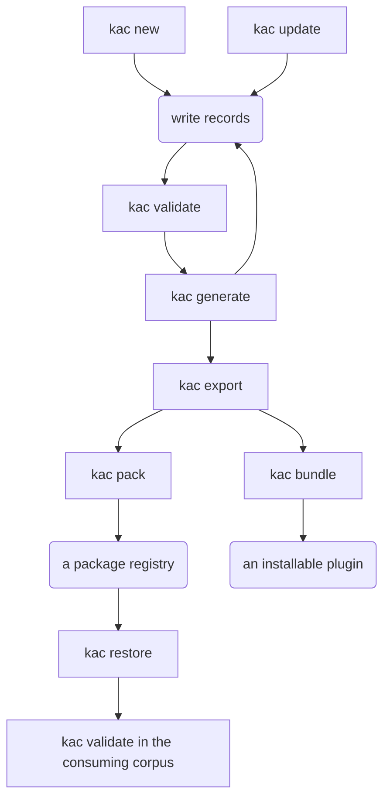

# CLI reference

One page per command. Each page opens with the usage the parser accepts, generated from `kac` itself. It then says what
the command does, works through examples with the output they print, and lists its known limits.

## The commands

<!-- BEGIN GENERATED: command-table -->

| Command                   | What it does                                            |
|---------------------------|---------------------------------------------------------|
| [`new`](new.md)           | Stand a corpus up in the folder you are in.             |
| [`validate`](validate.md) | Check the corpus against its schema.                    |
| [`generate`](generate.md) | Rewrite the parts of a corpus derived from its records. |
| [`restore`](restore.md)   | Fetch the corpora this one consumes.                    |
| [`export`](export.md)     | Write the corpus out as data a consumer can read.       |
| [`bundle`](bundle.md)     | Assemble the export into an installable agent plugin.   |
| [`pack`](pack.md)         | Seal the export into a versioned package.               |
| [`checks`](checks.md)     | List every check the validator can report.              |
| [`report`](report.md)     | Print a report over the corpus and what it imports.     |
| [`update`](update.md)     | Take a newer framework into a corpus.                   |

<!-- END GENERATED: command-table -->

## The order the commands run in

A square box is a command you type. A rounded one is what you do, or what you get.



Write a record, run [`validate`](validate.md), run [`generate`](generate.md), and write the next one.
[Running it in CI](../ci.md) runs the same two on a pull request. Run [`update`](update.md) when the framework moves,
or to adopt a type.

Everything after [`export`](export.md) is optional. A corpus that stands alone runs [`bundle`](bundle.md) to build a
plugin. A corpus another one consumes runs [`pack`](pack.md), and the consumer runs [`restore`](restore.md) before it
validates. [`checks`](checks.md) is on no branch: it reads the schema and prints what could fire.

## Which command to run

Each question about a corpus has one command. A corpus can fail one while passing the others.

| You want to know                                | Run                    |
|-------------------------------------------------|------------------------|
| are the records correct against the schema      | `kac validate`         |
| is the derived content in step with the records | `kac generate --check` |
| has this corpus fallen behind its framework     | `kac update --check`   |
| what could CI report against this corpus at all | `kac checks`           |

A check absent from a `validate` run has either not been declared or not been tripped, and `checks` tells the two
apart.

## Where a command runs

Every command but `new` reads a **corpus**, meaning one repository of knowledge records kept in git. It finds the
corpus by walking up from the working directory for a `.corpus.yaml`. It then walks up again from there for `.schema/`,
so one schema can serve several corpora in one repository.

`new` expects neither file above it. `--help` and `--version` need no corpus at all.

## Options every command takes

`--no-color` turns colour off, and so does `NO_COLOR` in the environment. A redirected stream has no colour, except on
a runner that renders colour in its logs, such as GitHub Actions. Set `NO_COLOR` where the output must be the same
everywhere.

`kac --help` lists the commands, and `kac <command> --help` prints that command's options. `--version` prints the
release and the commit it was built from:

<!-- transcript: illustration, kac --version -->

```text
0.41.0+c1c9621bc64317da9642f942d804d7dd22e41644
```

## Exit codes

| Code | Meaning                                                                                 |
|------|-----------------------------------------------------------------------------------------|
| `0`  | No errors. Warnings may still have been printed.                                        |
| `1`  | A corpus **error**, or a bad invocation (missing or unknown command or option).         |
| `2`  | A command found no corpus. `new`, `--version` and `--help` need none and answer anyway. |

A warning never changes the exit code.

[Getting started](../getting-started.md) runs the first of these commands on a machine with nothing installed.
