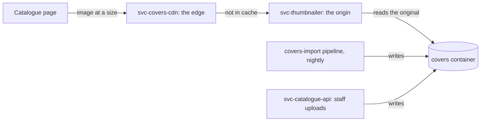

# How a jacket image reaches a page

`Explanation: exp-covers-path` `ACTIVE`

The path one jacket image takes, from the container it is stored in to the result list a borrower sees. Each leg of it
belongs to a different record.

## What this covers

The request path, the writers that fill the image container, and what a borrower sees when a leg of the path fails.
The routes, the cache key and the container itself belong to the service records. Where the rest of the estate sits
belongs to [exp-estate-overview].

## The request path

A catalogue page asks [svc-covers-cdn] for an image at a size. The edge serves it from cache, or forwards to
[svc-thumbnailer]. That service reads the original from blob storage, resizes it, and returns it. The edge caches the
resized result, keyed as [svc-covers-cdn] states.

Nothing calls [svc-thumbnailer] directly. [svc-covers-cdn] is the public hostname, and the origin sits behind the
platform network.

## How images get into storage

Two writers fill the container, and [svc-thumbnailer] is neither of them. The `covers-import` pipeline brings imagery
from [itg-bibliographic-data] each night. [svc-catalogue-api] writes the jackets branch staff upload for items the
supplier has no image for. [svc-covers-cdn] describes both.

## The repositories behind the path

No single service record can describe this path, because each leg is a service of its own. Each record lists the
repositories its own leg is changed in: [svc-covers-cdn] for the edge and the nightly import, [svc-thumbnailer] for the
origin, and [svc-catalogue-api] for the staff uploads.

## What a borrower sees when a leg fails

[ofr-discovery] states the ordinary case: a title the supplier sent no image for renders a placeholder. A failure of
[svc-thumbnailer] is worse, because [svc-covers-cdn] then has no origin and every uncached image breaks across the
estate.

## Where the detail lives

* [svc-covers-cdn] describes the edge, its routes and its cache key.
* [svc-thumbnailer] describes the origin and the container it reads.
* [svc-catalogue-api] describes the gateway that writes staff uploads.
* [itg-bibliographic-data] describes the supplier the nightly import takes its imagery from.
* [ofr-discovery] lists what a borrower uses to find a title, and states that a title with no image shows a placeholder.
* [exp-estate-overview] puts this path beside the rest of the estate.

[exp-estate-overview]: estate-overview.md
[itg-bibliographic-data]: ../integrations/bibliographic-data.md
[ofr-discovery]: ../offerings/discovery.md
[svc-catalogue-api]: ../services/catalogue-api.md
[svc-covers-cdn]: ../services/covers-cdn.md
[svc-thumbnailer]: ../services/thumbnailer.md
