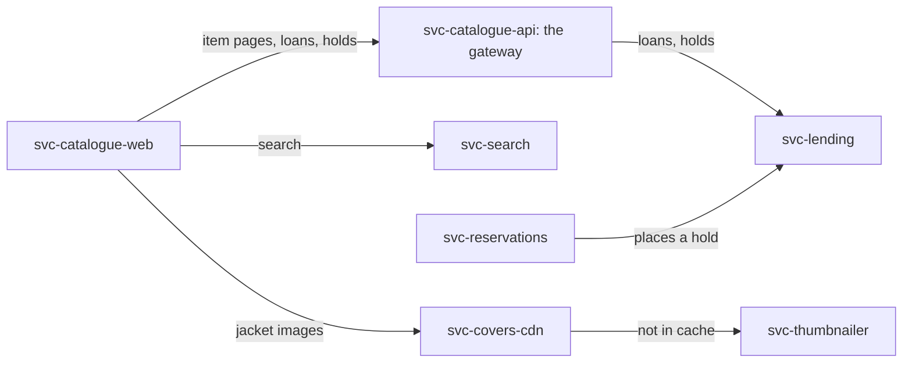

# How the estate fits together

`Explanation: exp-estate-overview` `ACTIVE`

A map of the consortium's systems, for somebody meeting them for the first time. Every fact below is stated in the
record it links to.

## What this covers

Every offering the consortium makes, every service behind it, and how they connect. What a service does in detail
belongs to that service's record. The path a jacket image takes belongs to [exp-covers-path].

## What a borrower can do

The consortium offers a [borrower](../glossary/example-libraries.md#borrower) three things. They find a title, they
borrow it, and they reserve one held at another [branch](../glossary/example-libraries.md#branch). [ofr-discovery],
[ofr-borrowing] and [ofr-reservations] each list the services behind one of them. Reservations is still being built,
and [ofr-reservations] says what remains. A service record does not say what it is for, so the three offerings are the
place to start.

## The public surfaces

[svc-catalogue-web] and [svc-reservations] are the sites a borrower opens. The branch terminals run those same
applications, so no separate service exists for them. [svc-covers-cdn] is public as well, and serves the jacket
imagery on their pages rather than a page of its own.

## The gateway and the services behind it

[svc-catalogue-api] is the route from the public catalogue into the estate, and the services behind it stay off the
public internet. Two routes go around it. The catalogue calls [svc-search] directly for the search box and faceted
browse. [svc-reservations] calls [svc-lending] directly over the private network, to place a hold. [exp-covers-path]
walks the imagery path.

## The legacy system

[svc-lending] wraps the legacy library management system and maps its database. Loans and holds ([dat-loans]) and
borrower records ([dat-borrowers]) are read and written through it, so both [ofr-borrowing] and [ofr-reservations]
depend on it.

## What runs without a borrower

[svc-notices] emails a borrower on a schedule and on events from the message bus. [svc-search] rebuilds its index from
that same bus. [svc-shelf-audit] checks the catalogue from outside once a night, and the platform's own synthetic
monitoring is replacing it.

## What the service graph leaves out

`depends-on` records a call, and a bus message is not a call. [svc-search] and [svc-notices] therefore appear
unconnected in the graph while being coupled to the estate as tightly as anything in it. [Services](../services.md)
states that convention, and each service lists its own topics under operational notes.

## Where the detail lives

* [ofr-discovery], [ofr-borrowing] and [ofr-reservations] say what a borrower can do, and which services do it.
* [svc-catalogue-web] and [svc-catalogue-api] describe the public site and its gateway.
* [svc-reservations] describes the reserve-and-pay site, and [svc-covers-cdn] the jacket imagery.
* [svc-lending] describes the strangler wrapper and the legacy database behind it. [dat-loans] and [dat-borrowers]
  describe the data it reads and writes.
* [svc-search], [svc-notices] and [svc-shelf-audit] describe the work that runs on a schedule or on an event.
* [Services](../services.md) states the conventions this catalogue follows, and why some coupling has no edge.
* [exp-covers-path] walks the path a jacket image takes, through [svc-thumbnailer].

[dat-borrowers]: ../data/borrowers.md
[dat-loans]: ../data/loans.md
[exp-covers-path]: covers-path.md
[ofr-borrowing]: ../offerings/borrowing.md
[ofr-discovery]: ../offerings/discovery.md
[ofr-reservations]: ../offerings/reservations.md
[svc-catalogue-api]: ../services/catalogue-api.md
[svc-catalogue-web]: ../services/catalogue-web.md
[svc-covers-cdn]: ../services/covers-cdn.md
[svc-lending]: ../services/lending.md
[svc-notices]: ../services/notices.md
[svc-reservations]: ../services/reservations.md
[svc-search]: ../services/search.md
[svc-shelf-audit]: ../services/shelf-audit.md
[svc-thumbnailer]: ../services/thumbnailer.md
