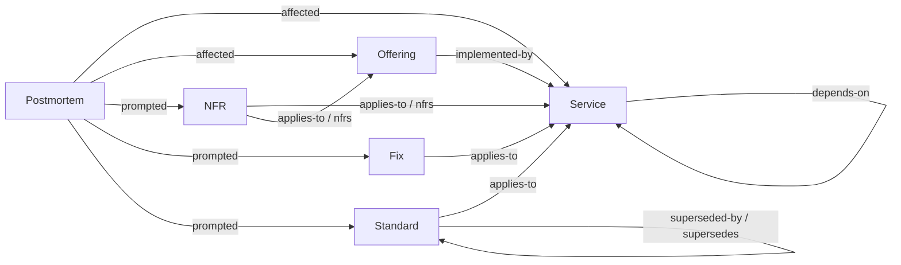

# Taxonomy

> The kinds of knowledge this corpus holds, what each is for, and what each is not.

The [decision table](#where-does-this-go) below is the quickest route to the right answer, and the
[disambiguations](#disambiguations) explain the calls that are genuinely close. Both cover the types this corpus adopted
and no others.

[Taxonomy][taxonomy] states what is true of every corpus: what a tier is and what the four ask, the shape a type takes
on disk, and what changing a taxonomy costs.

## Where does this go?

Scan the left column for what you are holding.

<!-- BEGIN GENERATED: types-placement -->

| You have…                                        | It goes in                       |
|--------------------------------------------------|----------------------------------|
| A problem with a known, verified resolution      | [Fixes](../fixes.md)             |
| A rule people must follow when building          | [Standards](../standards.md)     |
| A target for speed, uptime, or recovery          | [NFRs](../nfrs.md)               |
| An account of an incident and what caused it     | [Postmortems](../postmortems.md) |
| What a deployable component is and does          | [Services](../services.md)       |
| What the organisation offers a customer, and why | [Offerings](../offerings.md)     |

<!-- END GENERATED: types-placement -->

If nothing fits, raise it. A missing type is a taxonomy conversation, and the answer is sometimes a type this corpus has
not adopted.

## The types

The types are grouped by [tier][tiers]. Each type's own page lists the records filed under it.

<!-- BEGIN GENERATED: types-detail -->

### Decided: immutable once accepted, except to correct it

A decided record is about one moment: a decision, or an incident. Once accepted, it changes only to correct what it
misstates about that moment, or to fix its prose and spelling. It never follows what changed afterwards, and a changed
decision is a new record that supersedes it. A decided record states the constraints it asserts. It cites a descriptive
record for background, and never as the authority behind a constraint.

**[Postmortems](../postmortems.md).** What happened during an incident (timeline, impact, root cause, contributing
factors, actions). Blameless, and corrected in place wherever it turns out wrong. An ADR records the intention, and a
postmortem records the outcome.

### Normative: living, owned, reviewed

**[Fixes](../fixes.md).** A problem with a resolution somebody has verified. Each fix lists its verifications, so a
reader can see how far the resolution has been taken on trust.

**[NFRs](../nfrs.md).** A non-functional requirement (availability, latency, RPO, RTO) stated with how it is measured.
Capacity assumptions belong here too. A target nobody measures is an aspiration.

**[Standards](../standards.md).** The rulebook, imperative, BCP 14, with concrete examples and a conformance checklist.
Imperative throughout, in bold capitals: **MUST**, **MUST NOT**, **SHOULD**, **SHOULD NOT** and **MAY**. A MUST states
the outcome the owner answers for, and departing from it takes a deviation. A SHOULD states the usual way, and a reader
may depart from it by saying why. Only the `Rules` section binds, and every other section explains, shows or checks, so
a modal written outside it obliges nobody. Standards compose: the rules for a piece of work are the union of the folders
that apply to it, and of the standards each of those names in `depends-on`.

### Descriptive: living, must mirror reality

CI can check these against the estate itself. They also fall out of date fastest.

**[Offerings](../offerings.md).** What the organisation offers a customer, and why, with links to the services and NFRs
behind it. An offering sits above the work items. It links to the ones that detail it, the services that implement it,
the feature files that test it, and the NFRs that constrain it. An offering that accumulates detail of its own has
stopped being one.

**[Services](../services.md).** One deployable component: purpose, repos, platform, environments, dependencies, data
stores, owner. The record most other types point at. Without it, a cross-reference has nothing to resolve against.

<!-- END GENERATED: types-detail -->

## How the types relate

Every edge below is a cross-reference field the schema declares, so CI checks that it resolves to a document that
exists.

<!-- BEGIN GENERATED: types-graph -->

<!-- END GENERATED: types-graph -->

An edge labelled with two fields, such as `verifies / verified-by`, is a reciprocal pair. A pair written on one side
only fails the build. An edge with one field has no counterpart to keep in step.

Not every edge is a pair. A standard's `implements` points up at a policy, and the policy never points back. A
downstream corpus inherits both the policies and the standards above it. It also writes standards of its own, so
nobody sitting at the policy can know what implements it. An inherited standard stays as its own corpus wrote it, and
no corpus below rewrites it.

Nor does every edge leave from a whole document. A policy aligns with a framework through a single **clause** rather
than in its entirety, so the edge leaves the clause table and lands on a control: `pol-SCRT.KEYS` to Annex A A.8.24.
[Frameworks](../frameworks.md) is the far end of every one of those edges, and the only page that records this
corpus's standing against a framework. It has no `ref:`, so the graph above does not draw it.

## Disambiguations

The calls that are actually close. Each is written once, on the type its heading names first, and appears only where
this corpus holds both sides of it.

<!-- BEGIN GENERATED: types-versus -->

**Offering vs Service.** An offering is what a customer gets. A service is something the organisation deploys. One
offering usually spans several services. One service usually contributes to several offerings.

<!-- END GENERATED: types-versus -->

[taxonomy]: https://paul80nd.github.io/knowledge-as-code/framework/taxonomy/
[tiers]: https://paul80nd.github.io/knowledge-as-code/framework/taxonomy/#the-four-tiers
